# Git Mental Model

## References

- [The GIT Book - Chapter 10](https://git-scm.com/book/en/v2/Git-Internals-Plumbing-and-Porcelain)

## Mental Model

Spans from <https://git-scm.com/book/en/v2/Getting-Started-What-is-Git%3F>

### Stream of Snapshots

> Git thinks of its data more like a series of snapshots of a miniature filesystem. With Git, every time you commit, or save the state of your project, Git basically takes a picture of what all your files look like at that moment and stores a reference to that snapshot. To be efficient, if files have not changed, Git doesn’t store the file again, just a link to the previous identical file it has already stored. Git thinks about its data more like a stream of snapshots.

### Local Operations

> Most operations in Git need only local files and resources to operate — generally no information is needed from another computer on your network. 

> Git maintains a local database with all the history of the project (from the time of `git init` or clone). For example, to browse the history of the project, Git doesn’t need to go out to the server to get the history and display it for you — it simply reads it directly from your local database (stored in the special folder `.git`).

To share information with members of a team, the local database is pushed to a shared server that is accessible by all members of the team (e.g., github.com).  By design, this remote server has the same functionality as a local git database.  A remote git repository can be pulled or cloned onto a local repository.

### Data Integrity by Design

> Everything in Git is checksummed before it is stored and is then referred to by that checksum. This means it’s impossible to change the contents of any file or directory without Git knowing about it. 

> The mechanism that Git uses for this checksumming is called a **SHA-1 hash**. This is a 40-character string composed of hexadecimal characters (0–9 and a–f) and calculated based on the contents of a file or directory structure in Git. A SHA-1 hash looks something like this:
```
24b9da6552252987aa493b52f8696cd6d3b00373
```
Git stores everything in its database not by file name but by the hash value of its contents.

### Git Only Adds Data

> When you do actions in Git, nearly all of them only add data to the Git database. It is hard to get the system to do anything that is not undoable or to make it erase data in any way. After you commit a snapshot into Git, it is very difficult to lose, especially if you regularly push your database to another repository.

> It is almost always possible to undo changes and restore the project to any snapshot.

### Git Workflow: 3 States

> Git has three main states that your files can reside in:
- **Modified** means that you have changed the file but have not committed it to your database yet.
- **Staged** means that you have marked a modified file in its current version to go into your next commit snapshot.
- **Committed** means that the data is safely stored in your local database.

Accordingly, a Git project contains three sections: 
- the working tree
- the staging area, 
- the Git directory.

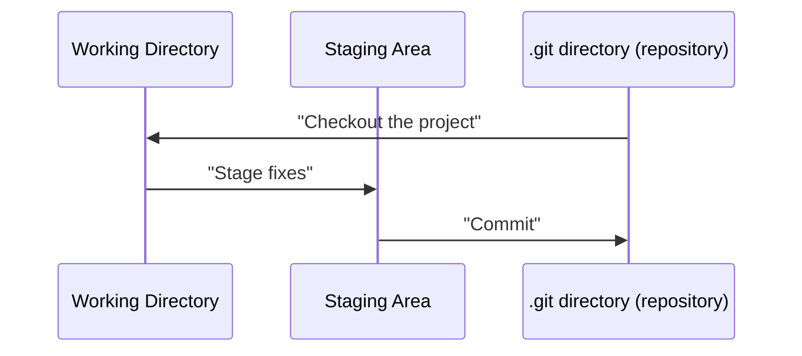

> The working tree is a single checkout of one version of the project. These files are pulled out of the compressed database in the Git directory and placed on disk for you to use or modify.

> The staging area is a file, contained in your Git directory, that stores information about what will go into your next commit. Its technical name is the “index”.

> The Git directory is where Git stores the metadata and object database for your project. This is the most important part of Git, and it is what is copied when you clone a repository from another computer.

#### Git Workflow

1. You modify files in your working tree.
2. You selectively stage just those changes you want to be part of your next commit, which adds only those changes to the staging area.
3. You do a commit, which takes the files as they are in the staging area and stores that snapshot permanently to your Git directory.

- If a particular version of a file is in the Git directory, it’s considered committed. 
- If it has been modified and was added to the staging area, it is staged. 
- If it was changed since it was checked out but has not been staged, it is modified. 


### Plumbing and Porcelain

Git commands can be organized in two groups:
- User level convenient commands to manage branches, commits, tags, staging, copy and restore from a remote repository.  These are called *porcelain*.
- Low level commands manipulating the primitive objects of the git database and the three sections (working tree, staging area and git database).  These are called *plumbing*.

## High Level Operations (Porcelain View)

### Creating a Repository

A repository can be created in two ways:
- Take a local directory that is currently not under version control, and turn it into a Git repository
```
> cd ~/project
> git init
# Add files to staging area
> git add *.c
> git add LICENSE
# Commit staging area to git database
> git commit -m 'Initial project version'
```
- Clone an existing Git repository from a remote Git server (e.g., github)
```
> git clone https://github.com/melhadad/llm-se-2027.git
```

### Tracking Files

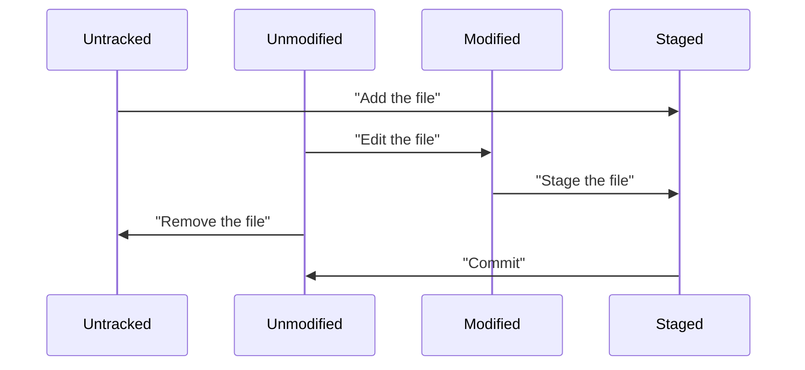

#### Checking the Status of the Project

1. The status of the files can be obtained by the status command:
```
> git status
On branch main
Your branch is up-to-date with 'origin/main'.
nothing to commit, working tree clean
```

2. Create a file, then check the status:
```
$ echo 'My Project' > README
$ git status
On branch main
Your branch is up-to-date with 'origin/main'.
Untracked files:
  (use "git add <file>..." to include in what will be committed)

    README

nothing added to commit but untracked files present (use "git add" to track)
```

3. Stage (Track) the File
```
$ git add README
$ git status
On branch main
Your branch is up-to-date with 'origin/main'.
Changes to be committed:
  (use "git restore --staged <file>..." to unstage)

    new file:   README
```

If you modify a file, stage it, then modify it again, the second modification is not staged.
The file will appear in status as both unstaged and modified to be committed (staged).

4. Commit

Create a new snapshot in the git database based on the staging area.

5. `git rm` and `git mv`

### Commit History

`git log` shows the history of the commits created in the current repository in reverse chronological order.

Each entry shown in the history is a commit in the current branch.
Each commit corresponds to a set of new file versions pushed to the git database.
Commits are documented with metadata fields - message, author, date, and a SHA-1 code.
Commits keep track of the parent commit (that is, the previous commit snapshot from which the new commit is built).

### Dealing with Remotes

A git repository can be associated to remote git repositories, and then perform push (send data to remote) and fetch (get data from remote) operations.  A single repository can be associated to multiple remotes.

```
❯ git remote -v
origin  https://github.com/melhadad/llm-se-2027.git (fetch)
origin  https://github.com/melhadad/llm-se-2027.git (push)
```

### Tagging

Git can tag specific points in a repository’s history as being important. 
Typically, people use this functionality to mark release points (v1.0, v2.0 and so on).

```
> git tag
v1.0
v2.0

> git tag -a v1.4 -m "my version 1.4"

> git show v1.4
tag v1.4
Tagger: Ben Straub <ben@straub.cc>
Date:   Sat May 3 20:19:12 2014 -0700

my version 1.4

commit ca82a6dff817ec66f44342007202690a93763949
Author: Scott Chacon <schacon@gee-mail.com>
Date:   Mon Mar 17 21:52:11 2008 -0700

    Change version number
```

### Branching

Branching means that we create a snapshot that diverges from the main line of development and we continue to do work in this isolated branch without messing with that main line. For example, one can open a branch to work on a new feature (this is called a "feature branch") and when we checkout this branch, we obtain a coherent view of the codebase that contains the changes made for this feature, without affecting the main branch.
Later, the feature branch can be "merged" onto the main branch.  Alternatively, one can open a branch for a version of the system to be maintained in the feature (such branches are called "long running branches").

Git branches in a very efficient manner. Branching and switching back and forth between branches is very fast. In effect, branches are just pointers to specific commit objects.

When you make a commit, Git stores a commit object that contains a pointer to the snapshot of the content you staged. This object also contains the author’s name and email address, the message that you typed, and pointers to the commit or commits that directly came before this commit (its parent or parents): zero parents for the initial commit, one parent for a normal commit, and multiple parents for a commit that results from a merge of two or more branches.

#### Branching Scenario

Here is an example of branching and merging.
1. Do some work on a website.
2. Create a branch for a new user story you’re working on.
3. Do some work in that branch.

At this stage, you receive a ticket that another issue is critical and you need a hotfix. 
You’ll do the following:

1. Switch to your production branch.
2. Create a branch to add the hotfix.
3. After it’s tested, merge the hotfix branch, and push to production.
4. Switch back to your original user story and continue working.

At the beginning, your project has a couple of commits already on the main branch.

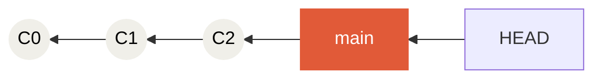

You decide that you’re going to work on issue #53. 
To create a new branch and switch to it at the same time, you run the git checkout command with the -b switch:
```
$ git checkout -b iss53
Switched to a new branch "iss53"
```
This is shorthand for:
```
$ git branch iss53
$ git checkout iss53
```

As a result, the commit tree is now updated as follows:

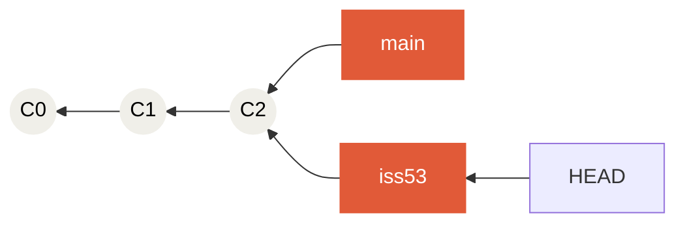

Note that the only change is that a new branch object was created (iss53) which points to the same commit as main
and that HEAD now points to this new branch (meaning that this branch is now the active branch).

You now edit a file, stage it and commit it into the current branch.
As a result, the iss53 branch moves forward (because HEAD is pointing to it).

```
# edit index.html
$ git commit -a -m 'Create new footer [issue 53]'
```

The new commit tree in git is now:
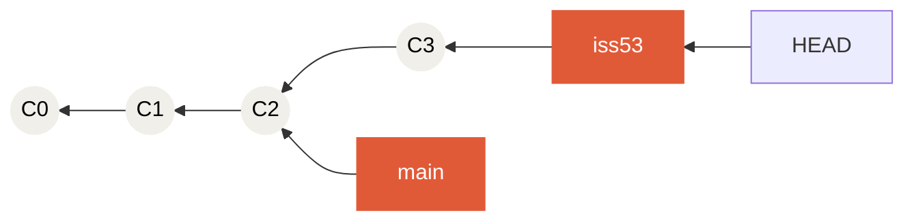

Now you get the call that there is an issue with the website, and you need to fix it immediately. 
With Git, you don’t have to deploy your fix along with the iss53 changes you’ve made, and you don’t have to put effort into reverting those changes before you can work on applying your fix to what is in production. All you have to do is switch back to your main branch.

However, before you do that, note that if your working directory or staging area has uncommitted changes that conflict with the branch you’re checking out, Git won’t let you switch branches. It’s best to have a clean working state when you switch branches. There are ways to get around this (namely, stashing). For now, let’s assume you’ve committed all your changes, so you can switch back to your main branch:

```
$ git checkout main
Switched to branch 'main'
```

At this point, your project working directory is exactly the way it was before you started working on issue #53, and you can concentrate on your hotfix. 
When you switch branches, Git resets your working directory to look like it did the last time you committed on that branch. 
It adds, removes, and modifies files automatically to make sure your working copy is what the branch looked like on your last commit to it.

Next, you have a hotfix to make. Let’s create a hotfix branch on which to work until it’s completed:
```
$ git checkout -b hotfix
Switched to a new branch 'hotfix'
$ edit index.html
$ git commit -a -m 'Fix broken email address'
[hotfix 1fb7853] Fix broken email address
 1 file changed, 2 insertions(+)
```

The new commit tree in git is now:
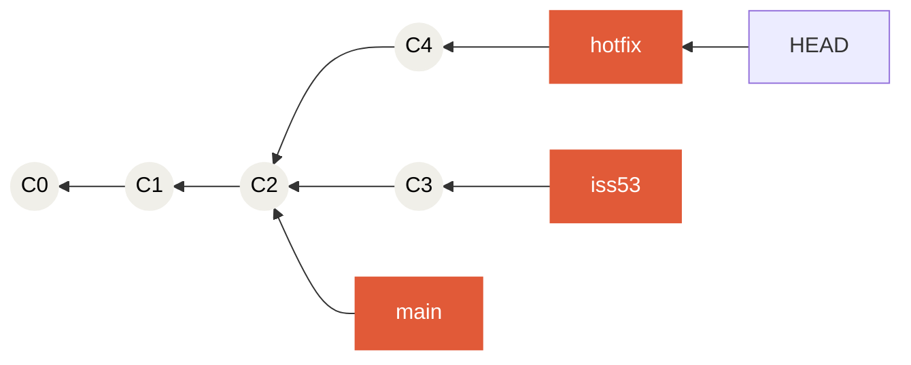

You run your tests, make sure the hotfix is what you want, and finally merge the hotfix branch back into your main branch to deploy to production. 
You do this with the git **merge** command:
```
$ git checkout main 
$ git merge hotfix  # merge hotfix into the current branch 'main'
Updating f42c576..3a0874c
Fast-forward
 index.html | 2 ++
 1 file changed, 2 insertions(+)
```

#### Fast-forward Merge

You notice the phrase **fast-forward** in that merge. 
Because the commit C4 pointed to by the branch hotfix you merged in was directly ahead of the commit C2 you’re on, Git simply moves the pointer forward. 
To phrase that another way, when you try to merge one commit with a commit that can be reached by following the first commit’s history, Git simplifies things by moving the pointer forward because there is no divergent work to merge together — this is called a “fast-forward.”

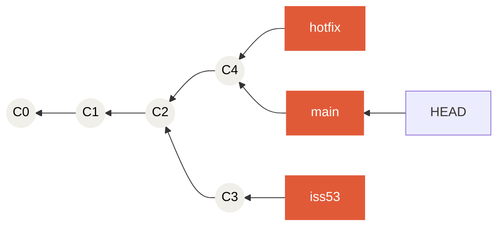

After the urgent fix is deployed, you switch back to the work you were doing before you were interrupted. 
However, first you’ll delete the hotfix branch, because you no longer need it — the main branch points at the same place. 
You can delete it with the -d option to git branch:
```
$ git branch -d hotfix
Deleted branch hotfix (3a0874c).
```
Now you can switch back to your work-in-progress branch on issue #53 and continue working on it.
```
$ git checkout iss53
Switched to branch "iss53"
$ edit index.html
$ git commit -a -m 'Finish the new footer [issue 53]'
[iss53 ad82d7a] Finish the new footer [issue 53]
1 file changed, 1 insertion(+)
```

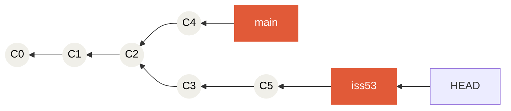

Note that the work you did in hotfix (C4) is not contained in the files in the iss53 branch. 
If you need to pull it in, you can merge your main branch into your iss53 branch by running `git merge main`.
Alternatively, you can wait to integrate those changes until you decide to pull the iss53 branch back into main later.

#### Typical Merge (Three-way Merge)

You now decide that your issue #53 work is complete and ready to be merged into your main branch. 
In order to do that, you’ll merge your iss53 branch into main, like you merged your hotfix branch earlier. 
All you have to do is check out the branch you wish to merge into and then run the git merge command:
```
$ git checkout main
Switched to branch 'main'
$ git merge iss53
Merge made by the 'recursive' strategy.
index.html |    1 +
1 file changed, 1 insertion(+)
```

This is a different configuration than the earlier hotfix merge. 
In this case, the development history has diverged from some older point. 
Because the commit on the branch you’re on isn’t a direct ancestor of the branch you’re merging in, Git has to do some work. 
In this case, Git does a simple three-way merge, using the snapshots pointed to by the source branch (iss53), the target branch (main) and the common ancestor of the two (c2).

Instead of just moving the branch pointer forward, Git creates a new snapshot that results from this three-way merge and automatically creates a new commit that points to it. 
This is referred to as a merge commit, and is special in that it has more than one parent.

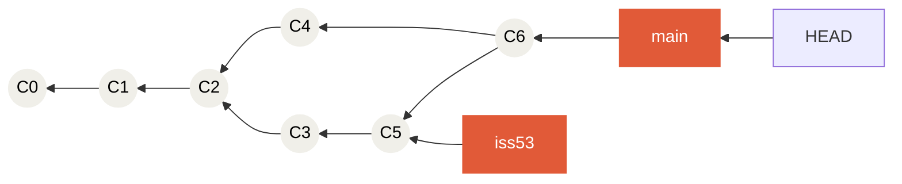

Now that the work is merged in, you have no further need for the iss53 branch. 
You can close the issue in your issue-tracking system, and delete the branch:
```
$ git branch -d iss53
```

#### Merge Conflicts

Occasionally, the merge process doesn’t go smoothly: If you changed the same part of the same file differently in the two branches you’re merging, Git won’t be able to merge them cleanly. 
If your fix for issue #53 modified the same part of a file as the hotfix branch, you’ll get a merge conflict that looks something like this:
```
$ git merge iss53
Auto-merging index.html
CONFLICT (content): Merge conflict in index.html
Automatic merge failed; fix conflicts and then commit the result.
```
Git hasn’t automatically created a new merge commit. It has paused the process while you resolve the conflict. If you want to see which files are unmerged at any point after a merge conflict, you can run git status:
```
$ git status
On branch main
You have unmerged paths.
  (fix conflicts and run "git commit")

Unmerged paths:
  (use "git add <file>..." to mark resolution)

    both modified:      index.html

no changes added to commit (use "git add" and/or "git commit -a")
```

Anything that has merge conflicts and hasn’t been resolved is listed as unmerged. 

There are tools to help you resolve the file conflicts (that show the diverging sections in the file modified in both branches).  These tools often show the conflict in a notation similar to this one:

```
<<<<<<< HEAD:index.html
<div id="footer">contact : email.support@github.com</div>
=======
<div id="footer">
 please contact us at support@github.com
</div>
>>>>>>> iss53:index.html
```

This means the version in HEAD (your main branch, because that was what you had checked out when you ran your merge command) is the top part of that block (everything above the =======), while the version in your iss53 branch looks like everything in the bottom part. In order to resolve the conflict, you have to either choose one side or the other or merge the contents yourself.

Once the conflict is resolved (manually), you stage the file again (with git add), which marks the conflict as resolved.  You can then complete the commit, which finalizes the merge operation.

#### Rebasing

In some cases, a complex merge (not a fast-forward) can be performed using a different stragy called **rebase**.

Read <https://git-scm.com/book/en/v2/Git-Branching-Rebasing> to understand what rebasing is and how it compares to three-way merge described above.

There are strict indications that determine when rebasing can be used and when it is preferable to use the regular three-way merge.


## Plumbing View

### Key Entities

When you run `git init` in a new or existing directory, Git creates the `.git` directory.
It contains the data that Git manipulates. The key components are:
- **`objects`**: all the content of the database (all the versions of all the files)
- **`refs`**: pointers into commit objects in the objects data (branches, tags, remotes)
- **`HEAD`**: points to the branch that is currently checked out
- **`index`**: staging area information

### What are Objects

The objects folder is the encoding of snapshots into the git database.
Objects are identified by a hash-code which is a checksum of 40 characters that is derived from the content of a single file.  Git uses these hashcodes as immutable pointers to immutable nodes in a graph of objects.

The plumbing command `git hash-object` takes data, stores it in the `.git/objects` directory (the object database), and returns the unique key that now refers to that data object.
```
echo 'test content' | git hash-object --stdin   
d670460b4b4aece5915caf5c68d12f560a9fe3e4
```
In this case, the content is not written in .git/objects because we did not use the `-w` option.
We used the `--stdin` option to get the content from standard input instead of reading it from a file.

This is how Git stores the content initially — as a single file per piece of content, named with the SHA-1 checksum of the content and its header. The subdirectory is named with the first 2 characters of the SHA-1, and the filename is the remaining 38 characters.

Once you have content in your object database, you can examine that content with the `git cat-file` command for inspecting Git objects. Passing `-p` to `cat-file` instructs the command to first figure out the type of content, then display it appropriately:

```
$ git cat-file -p d670460b4b4aece5915caf5c68d12f560a9fe3e4
test content
```

The `objects` folder contains content of different types:
- blob: contains a single file.
- tree: corresponds to a folder which can contain blobs or sub-trees.
- commit objects: a structured commit object which refers to a snapshot tree.

### Versions with Blob Objects

Blobs in the git repository are immutable. 
This allows simple version control on a file. 

First, create a new file and save its contents in your database:
```
$ echo 'version 1' > test.txt
$ git hash-object -w test.txt
83baae61804e65cc73a7201a7252750c76066a30
```

Then, write some new content to the file, and save it again:
```
$ echo 'version 2' > test.txt
$ git hash-object -w test.txt
1f7a7a472abf3dd9643fd615f6da379c4acb3e3a
```
Y
our object database now contains both versions of this new file (as well as the first content you stored there):
```
$ find .git/objects -type f
.git/objects/1f/7a7a472abf3dd9643fd615f6da379c4acb3e3a
.git/objects/83/baae61804e65cc73a7201a7252750c76066a30
.git/objects/d6/70460b4b4aece5915caf5c68d12f560a9fe3e4
```

At this point, you can delete your local copy of that test.txt file, then use Git to retrieve, from the object database, either the first version you saved:
```
$ git cat-file -p 83baae61804e65cc73a7201a7252750c76066a30 > test.txt
$ cat test.txt
version 1
```
or the second version:
```
$ git cat-file -p 1f7a7a472abf3dd9643fd615f6da379c4acb3e3a > test.txt
$ cat test.txt
version 2
```

You can have Git tell you the object type of any object in Git, given its SHA-1 key, with git cat-file -t:
```
$ git cat-file -t 1f7a7a472abf3dd9643fd615f6da379c4acb3e3a
blob
```

Remembering the SHA-1 key for each version of your file isn’t practical; plus, you aren’t storing the filename in your system — just the content. To keep track of filenames and their association to specific versions of blobs, git uses *tree objects*.

### Tree Objects

Trees in git store filenames and group files together. Git stores content in a manner similar and simplified to a UNIX filesystem. All the content is stored as tree and blob objects, with trees corresponding to UNIX directory entries and blobs corresponding more or less to inodes or file contents. A single tree object contains one or more entries, each of which is the SHA-1 hash of a blob or subtree with its associated mode, type, and filename. For example, let’s say you have a project where the most-recent tree looks something like:
```
$ git cat-file -p main^{tree}
100644 blob a906cb2a4a904a152e80877d4088654daad0c859      README
100644 blob 8f94139338f9404f26296befa88755fc2598c289      Rakefile
040000 tree 99f1a6d12cb4b6f19c8655fca46c3ecf317074e0      lib
```

The `main^{tree}` syntax specifies the tree object that is pointed to by the last commit on your main branch. Notice that the lib subdirectory isn’t a blob but a pointer to another tree:
```
$ git cat-file -p 99f1a6d12cb4b6f19c8655fca46c3ecf317074e0
100644 blob 47c6340d6459e05787f644c2447d2595f5d3a54b      simplegit.rb
```

#### Creating Tree Objects

Git creates a tree by taking the state of your staging area (internally stored in the `index` folder) and writing a series of tree objects from it. 

To create a tree object at the low level, you first have to set up an index by staging some files. To create an index with a single entry — the first version of your test.txt file — you can use the plumbing command `git update-index`. 

You use this command to artificially add the earlier version of the test.txt file to a new staging area. You must pass it the --add option because the file doesn’t yet exist in your staging area (you don’t even have a staging area set up yet) and --cacheinfo because the file you’re adding isn’t in your directory but is in your database. Then, you specify the mode, SHA-1, and filename:
```
$ git update-index --add --cacheinfo 100644 \
  83baae61804e65cc73a7201a7252750c76066a30 test.txt
```

In this case, you’re specifying a mode of 100644, which means it’s a normal file. Other options are 100755, which means it’s an executable file; and 120000, which specifies a symbolic link. These modes are taken from UNIX modes and they are the only ones that are valid for files (blobs) in Git.

Now, you can use `git write-tree` to write the staging area out to a tree object:
```
$ git write-tree
d8329fc1cc938780ffdd9f94e0d364e0ea74f579

$ git cat-file -p d8329fc1cc938780ffdd9f94e0d364e0ea74f579
100644 blob 83baae61804e65cc73a7201a7252750c76066a30      test.txt
```

You can also verify that this is a tree object using the same git cat-file command you saw earlier:
```
$ git cat-file -t d8329fc1cc938780ffdd9f94e0d364e0ea74f579
tree
```

You’ll now create a new tree with the second version of test.txt and a new file as well:

```
$ echo 'new file' > new.txt
$ git update-index --cacheinfo 100644 \
  1f7a7a472abf3dd9643fd615f6da379c4acb3e3a test.txt
$ git update-index --add new.txt
```

Your staging area now has the new version of test.txt as well as the new file new.txt. Write out that tree (recording the state of the staging area or index to a tree object) and see what it looks like:

```
$ git write-tree
0155eb4229851634a0f03eb265b69f5a2d56f341
$ git cat-file -p 0155eb4229851634a0f03eb265b69f5a2d56f341
100644 blob fa49b077972391ad58037050f2a75f74e3671e92      new.txt
100644 blob 1f7a7a472abf3dd9643fd615f6da379c4acb3e3a      test.txt
```

Notice that this tree has both file entries and also that the test.txt SHA-1 is the “version 2” SHA-1 from earlier (1f7a7a). 


### Commit Objects

With blobs and trees, we can construct trees with names of files that point to various versions of their content at different snapshots.  The earlier problem remains: you must remember the tree SHA-1 values in order to recall the snapshots. You also don’t have any information about who saved the snapshots, when they were saved, or why they were saved. This is the basic information that the **commit object** stores.

To create a commit object, you call `commit-tree` and specify a single tree SHA-1 and which commit objects, if any, directly preceded it. Start with the first tree you wrote:

```
$ echo 'First commit' | git commit-tree d8329f
fdf4fc3344e67ab068f836878b6c4951e3b15f3d
```

Now you can look at your new commit object with `git cat-file`:

```
$ git cat-file -p fdf4fc3
tree d8329fc1cc938780ffdd9f94e0d364e0ea74f579
author Scott Chacon <schacon@gmail.com> 1243040974 -0700
committer Scott Chacon <schacon@gmail.com> 1243040974 -0700

First commit
```

The format for a commit object is simple: it specifies the top-level tree for the snapshot of the project at that point; the parent commits if any (the commit object described above does not have any parents); the author/committer information (which uses your user.name and user.email configuration settings and a timestamp); a blank line, and then the commit message.

You can write additional commit objects, each referencing the commit that came directly before it:

```
$ echo 'Second commit' | git commit-tree 0155eb -p fdf4fc3
cac0cab538b970a37ea1e769cbbde608743bc96d

$ echo 'Third commit'  | git commit-tree 3c4e9c -p cac0cab
1a410efbd13591db07496601ebc7a059dd55cfe9
```

Each of the three commit objects points to one of the snapshot trees you created from staging. You have a real Git history now that you can view with the `git log` command, if you run it on the last commit SHA-1:

```
$ git log --stat 1a410e
commit 1a410efbd13591db07496601ebc7a059dd55cfe9
Author: Scott Chacon <schacon@gmail.com>
Date:   Fri May 22 18:15:24 2009 -0700

	Third commit

 bak/test.txt | 1 +
 1 file changed, 1 insertion(+)

commit cac0cab538b970a37ea1e769cbbde608743bc96d
Author: Scott Chacon <schacon@gmail.com>
Date:   Fri May 22 18:14:29 2009 -0700

	Second commit

 new.txt  | 1 +
 test.txt | 2 +-
 2 files changed, 2 insertions(+), 1 deletion(-)

commit fdf4fc3344e67ab068f836878b6c4951e3b15f3d
Author: Scott Chacon <schacon@gmail.com>
Date:   Fri May 22 18:09:34 2009 -0700

    First commit

 test.txt | 1 +
 1 file changed, 1 insertion(+)
```

This demonstrates how the low-level (plumbing) operations can build up a Git history without using any of the front end (porcelain) commands. 

This is essentially what Git does when you run the `git add` and `git commit` commands — it stores blobs for the files that have changed, updates the index, writes out trees, and writes commit objects that reference the top-level trees and the commits that came immediately before them. These three main Git objects — the blob, the tree, and the commit — are initially stored as separate files in your .git/objects directory. Here are all the objects in the example directory now, commented with what they store:

```
$ find .git/objects -type f
.git/objects/01/55eb4229851634a0f03eb265b69f5a2d56f341 # tree 2
.git/objects/1a/410efbd13591db07496601ebc7a059dd55cfe9 # commit 3
.git/objects/1f/7a7a472abf3dd9643fd615f6da379c4acb3e3a # test.txt v2
.git/objects/3c/4e9cd789d88d8d89c1073707c3585e41b0e614 # tree 3
.git/objects/83/baae61804e65cc73a7201a7252750c76066a30 # test.txt v1
.git/objects/ca/c0cab538b970a37ea1e769cbbde608743bc96d # commit 2
.git/objects/d6/70460b4b4aece5915caf5c68d12f560a9fe3e4 # 'test content'
.git/objects/d8/329fc1cc938780ffdd9f94e0d364e0ea74f579 # tree 1
.git/objects/fa/49b077972391ad58037050f2a75f74e3671e92 # new.txt
.git/objects/fd/f4fc3344e67ab068f836878b6c4951e3b15f3d # commit 1
```

If you follow all the internal pointers, you get an object graph something like this:

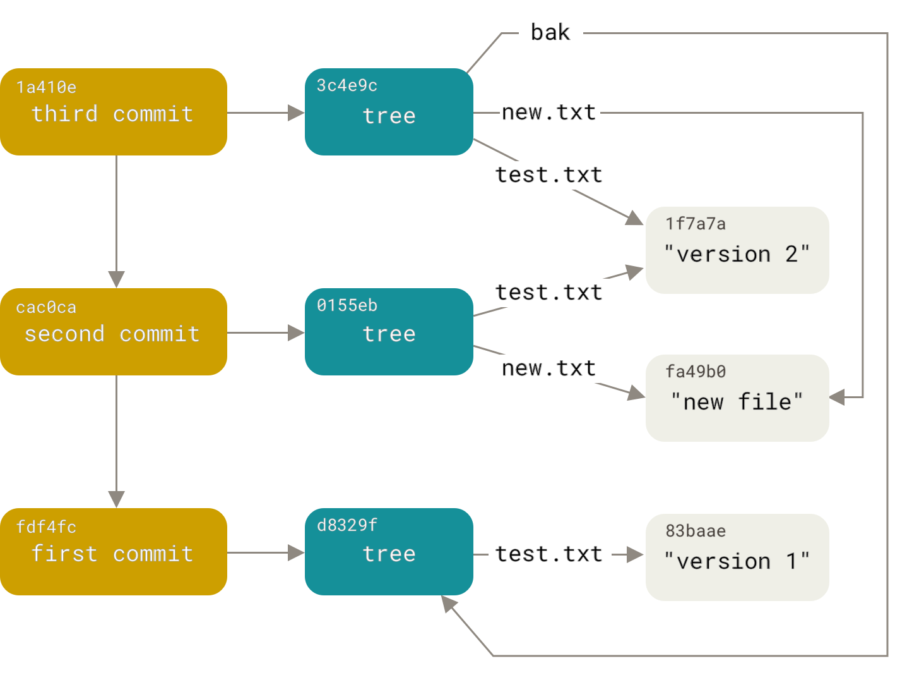


### Git References

If you were interested in seeing the history of your repository reachable from commit, say, 1a410e, you could run something like `git log 1a410e` to display that history, but you would still have to remember that 1a410e is the commit you want to use as the starting point for that history. (Basically, we keep backing up one step at a time and maintaining mapping from names to SHA-1 hashcodes).

Instead, it would be easier if you had a file in which you could store that SHA-1 value under a simple name so you could use that simple name rather than the raw SHA-1 value.

In Git, these simple names are called “references” or “refs”; you can find the files that contain those SHA-1 values in the .git/refs directory. In the current project, this directory contains no files, but it does contain a simple structure:

```
$ find .git/refs
.git/refs
.git/refs/heads
.git/refs/tags
$ find .git/refs -type f
```

To create a new reference that will help you remember where your latest commit is, you can technically do something as simple as this:

```
$ echo 1a410efbd13591db07496601ebc7a059dd55cfe9 > .git/refs/heads/main
```

Now, you can use the head reference you just created instead of the SHA-1 value in your Git commands:

```
$ git log --pretty=oneline main
1a410efbd13591db07496601ebc7a059dd55cfe9 Third commit
cac0cab538b970a37ea1e769cbbde608743bc96d Second commit
fdf4fc3344e67ab068f836878b6c4951e3b15f3d First commit
```

You aren’t encouraged to directly edit the reference files; instead, Git provides the safer command `git update-ref` to do this if you want to update a reference:

```
$ git update-ref refs/heads/main 1a410efbd13591db07496601ebc7a059dd55cfe9
```

That’s basically what a branch in Git is: a simple pointer or reference to the head of a line of work. To create a branch back at the second commit, you can do this:

```
$ git update-ref refs/heads/test cac0ca
```

Your branch will contain only work from that commit down:

```
$ git log --pretty=oneline test
cac0cab538b970a37ea1e769cbbde608743bc96d Second commit
fdf4fc3344e67ab068f836878b6c4951e3b15f3d First commit
```

Now, your Git database conceptually looks something like this:

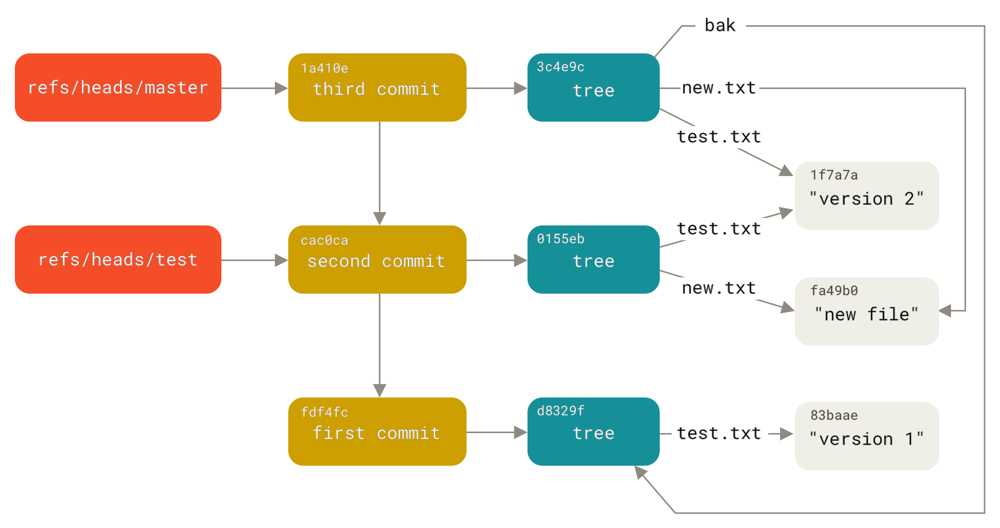


#### The HEAD

The question now is, when you run `git branch <branch>`, how does Git know the SHA-1 of the last commit? The answer is the HEAD file. Usually the HEAD file is a symbolic reference to the branch you’re currently on. By symbolic reference, we mean that unlike a normal reference, it contains a pointer to another reference.

If you look at the file, you’ll normally see something like this:
```
$ cat .git/HEAD
ref: refs/heads/main
```
If you run git checkout test, Git updates the file to look like this:

```
$ cat .git/HEAD
ref: refs/heads/test
```
When you run `git commit`, it creates the commit object, specifying the parent of that commit object to be whatever SHA-1 value the reference in HEAD points to.

You can also manually edit this file, but again a safer command exists to do so: `git symbolic-ref`. You can read the value of your HEAD via this command:

```
$ git symbolic-ref HEAD
refs/heads/main
```
You can also set the value of HEAD using the same command:

```
$ git symbolic-ref HEAD refs/heads/test
$ cat .git/HEAD
ref: refs/heads/test
```

#### Tags

We just finished discussing Git’s three main object types (blobs, trees and commits), but there is a fourth. The tag object is very much like a commit object — it contains a tagger, a date, a message, and a pointer. The main difference is that a tag object generally points to a commit rather than a tree. It’s like a branch reference, but it never moves — it always points to the same commit but gives it a friendlier name.

